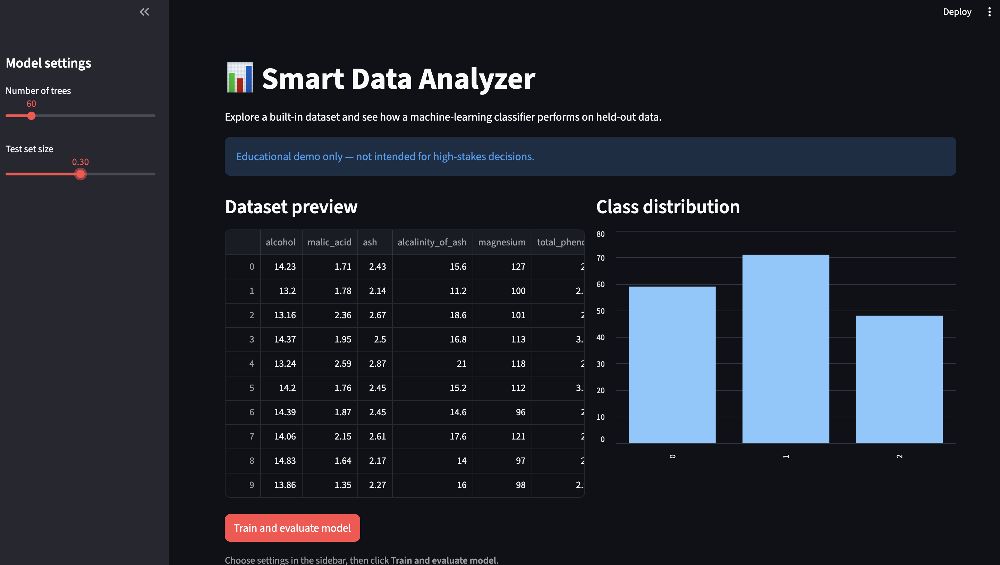
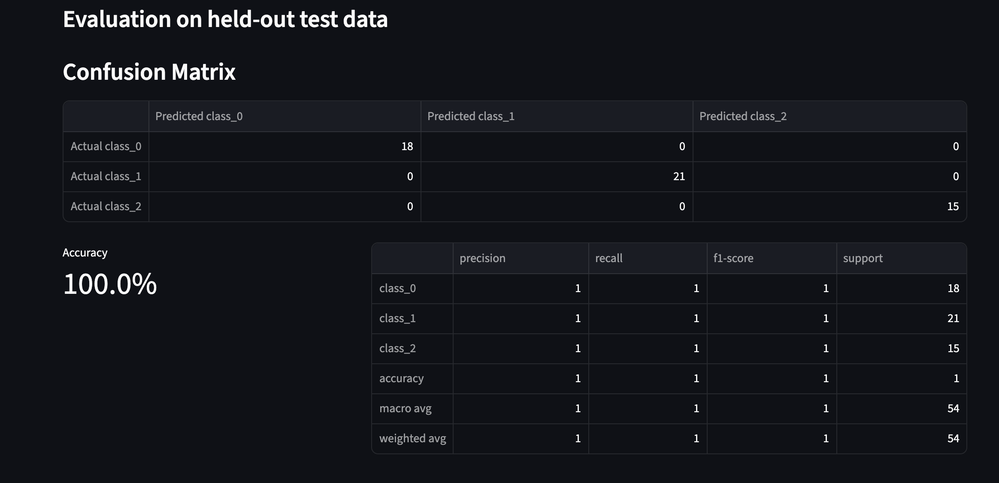
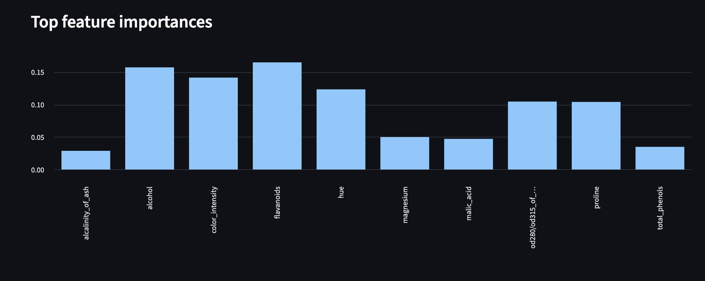

# Smart Data Analyzer

A machine-learning dashboard that explores scikit-learn's Wine dataset and evaluates a Random Forest classifier.

## Screenshots

### Dashboard



### Model Evaluation



### Feature Importance



## Features

- Preview the dataset and view class distribution
- Train a Random Forest classifier
- Adjust the number of trees and test-set size
- View accuracy, precision, recall, and F1-score
- Compare actual and predicted classes with a confusion matrix
- Explore feature importance
- Run automated tests with pytest

## Tech Stack

Python, pandas, scikit-learn, Streamlit, pytest

## Project Structure

```text
smart-data-analyzer/
├── screenshots/
│   ├── dashboard.png
│   ├── model-evaluation.png
│   └── feature-importance.png
├── src/
│   ├── __init__.py
│   ├── app.py
│   └── model.py
├── tests/
│   └── test_model.py
├── requirements.txt
├── .gitignore
└── README.md
```

## Getting Started

### Requirements

- Python 3.9 or newer
- pip

### 1. Clone the repository

```bash
git clone https://github.com/ahmedkhouya-exe/ahmedkhouya-exe.git
cd ahmedkhouya-exe/smart-data-analyzer
```

### 2. Create and activate a virtual environment

```bash
python -m venv .venv
source .venv/bin/activate
```

On Windows, activate it with:

```bash
.venv\\Scripts\\activate
```

### 3. Install dependencies

```bash
python -m pip install -r requirements.txt
```

### 4. Run the app

```bash
streamlit run src/app.py
```

### 5. Run tests

```bash
python -m pytest tests -v
```

## Model Evaluation

The dashboard displays accuracy, a classification report, a confusion matrix, and the model's top feature importances. Results can change with the selected test-set size and model settings.

## Author

**Ahmed Khouya** · [GitHub profile](https://github.com/ahmedkhouya-exe)
